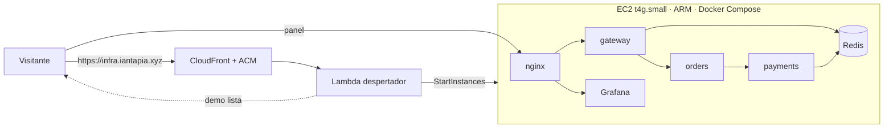
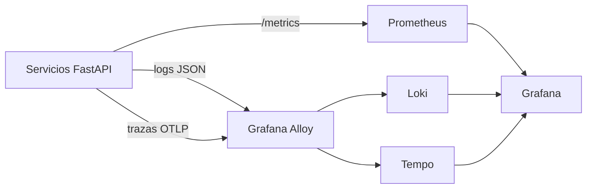

# 💥 Break My Infra

**Rompe un sistema en producción y mira cómo lo detecta y se recupera solo, en tiempo real.**

Demo interactiva de *chaos engineering* y observabilidad: microservicios instrumentados con métricas, logs y trazas, desplegados en AWS con Terraform y una arquitectura **scale-to-zero** que cuesta **~$2 al mes**.

### 👉 [infra.iantapia.xyz](https://infra.iantapia.xyz)


---

## 🎯 ¿Qué hace?

1. Entras a la demo → la infraestructura **se enciende bajo demanda** (~30 s)
2. Presionas un botón de caos → el sistema **falla de verdad**
3. Ves en Grafana cómo suben la latencia y los errores, y los logs del incidente **en vivo**
4. A los 45 s todo **vuelve a la normalidad sin intervención**
5. Sin visitas por 10 min → la máquina **se apaga sola** 💤

## 💣 Escenarios de caos

| Escenario | Qué pasa por dentro | Qué se observa |
|---|---|---|
| 🚀 **Pico de tráfico** | 10× requests → se agota el pool de conexiones a la DB | p95 de 200 ms → 4 s, errores 503 en cascada |
| 💥 **Inyectar errores** | 30% de los pagos fallan | Error rate en rojo, logs de error en vivo |
| 🐢 **Base de datos lenta** | +600–1200 ms por pago | p95 cruza el umbral de 500 ms; la traza señala el servicio culpable |

---

## 🏗️ Arquitectura

### Infraestructura (AWS)


### Observabilidad


---

## 🧠 Decisiones técnicas

| Decisión | Por qué |
|---|---|
| **Scale-to-zero** (Lambda enciende la EC2, un cron la apaga) | Bajó el costo de ~$17 a ~$2 al mes. El tráfico interno no cuenta como visita: solo el latido del panel |
| **Banderas de caos en Redis con TTL** | Compartidas entre servicios y con auto-revert gratis: `SET chaos:errors 1 EX 45` |
| **Generador de carga de lazo abierto** | Simula usuarios reales que no esperan: la latencia genera colas, como en producción |
| **Pool de conexiones limitado** | Un pico de tráfico satura un recurso finito → falla en cascada realista |
| **Tracing distribuido** (`trace_id` propagado en headers) | Correlaciona el error de `orders` con su causa en `payments` |
| **Logs estructurados en JSON** | Filtrar por campos numéricos: `\| json \| latency_ms > 120` |
| **Dashboard como código** | Grafana renace desde git: infraestructura reproducible |
| **`resolver` dinámico en nginx** | Evita 502/404 al recrear contenedores (nginx cacheaba IPs viejas) |

## 🔒 Seguridad y control de costos

- **Sin SSH**: administración por SSM; un solo puerto público (80)
- **IMDSv2 obligatorio** e IAM de **mínimo privilegio** (la Lambda solo puede encender *esa* instancia)
- **Rate limiting en nginx**: 20 req/s por IP y 6 activaciones de caos por minuto
- **Sesiones**: 20 min por persona, máximo 3 a la vez, cooldown por IP
- **Topes de costo**: máx. 1 h encendida por arranque, 3 arranques por día, CPU en modo `standard` (sin cargos extra)
- **Presupuesto de AWS** con alertas y etiquetas `Project` para FinOps

## 💰 Costos

| Concepto | Costo mensual |
|---|---|
| EC2 t4g.small (solo mientras alguien la usa) | ~$0.10 – $2.00 |
| Disco EBS 16 GB | ~$1.30 |
| Lambda + CloudFront + ACM | $0 (nivel gratuito) |
| **Total** | **~$1.50 – $3.30** |

---

## 🛠️ Stack

| Capa | Tecnologías |
|---|---|
| Servicios | Python · FastAPI · Redis |
| Observabilidad | OpenTelemetry · Prometheus · Loki · Tempo · Grafana · Grafana Alloy |
| Infraestructura | Docker Compose · nginx · Terraform |
| AWS | EC2 (Graviton) · Lambda · CloudFront · ACM · IAM · SSM |

## 🚀 Correrlo en local

```bash
git clone https://github.com/IanT1112/break-my-infra.git
cd break-my-infra
docker compose up -d
```
Abre **http://localhost:8080**

## ☁️ Desplegar en AWS

```bash
cd infra
terraform init
terraform apply
```
Terraform crea la EC2 (que se instala sola), la Lambda, CloudFront y el certificado.

## 📁 Estructura

```
├── services/        # gateway, orders, payments (FastAPI) + módulos comunes
├── frontend/        # panel de caos + configuración de nginx
├── observability/   # Prometheus, Loki, Tempo, Alloy y Grafana (como código)
├── infra/           # Terraform: EC2, Lambda, CloudFront, IAM
└── docker-compose*.yml
```

## 🗺️ Próximos pasos

- [ ] Alertas con Alertmanager + medición de MTTD/MTTR en el panel
- [ ] CI/CD con GitHub Actions y OIDC (sin credenciales guardadas)

---

**Desarrollado por [Ian Tapia](https://iantapia.xyz)** · Estudiante de Ingeniería de Sistemas e IA